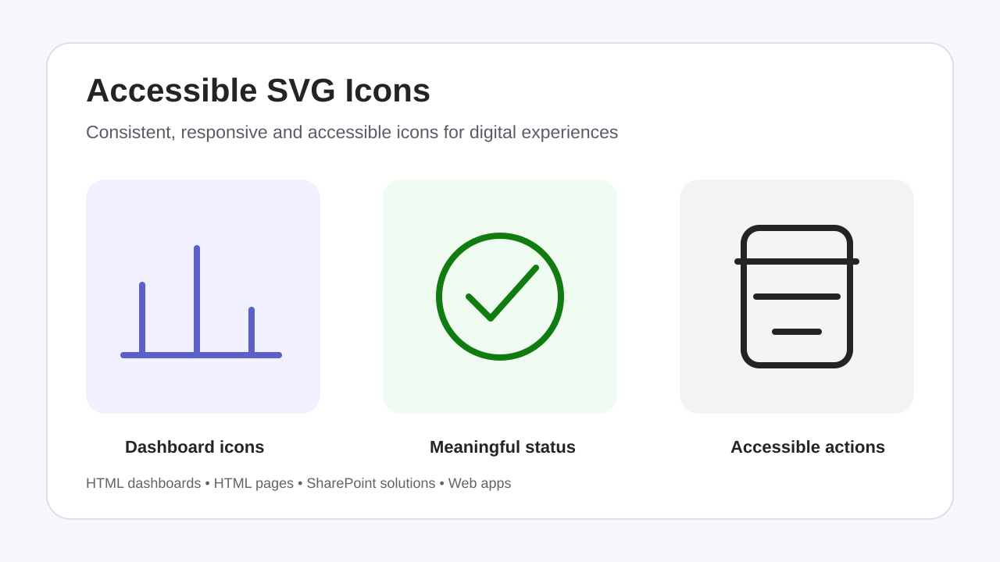

# Accessible SVG Icons

Creates, improves, and audits accessible SVG icons for HTML dashboards, HTML pages, SharePoint solutions, web applications, and other digital interfaces. Use it when you need a consistent icon system, want to replace emoji or inconsistent icons, or need to review SVG and surrounding HTML for accessibility, responsive behaviour, and theme support.

## What you get

- A pre-design review of the available HTML, CSS, existing icons, audience, interface purpose, design tokens, interaction requirements, themes, and viewport constraints
- A recommendation on whether an icon will improve comprehension, hierarchy, wayfinding, scannability, status recognition, or action recognition
- An icon plan covering meaning, purpose classification, visible text, line or solid treatment, target sizes, accessible naming, theme strategy, and interaction requirements
- Implementation-ready SVG, HTML, CSS, or component code
- Decorative, informative, and interactive icon patterns with appropriate assistive-technology treatment
- Responsive sizing and checks at 16, 20, 24, and 32 CSS pixels
- Light, dark, and forced-colour theme support using `currentColor` and semantic tokens
- Keyboard focus, pointer-target, contrast, and non-colour status guidance
- Line and solid variants that follow one consistent visual system
- An audit and validation summary for existing SVG and HTML

## When to use

Ask Copilot to:

- "Create four consistent inline SVG icons for these dashboard KPI cards."
- "Replace the emoji on this HTML page with responsive SVG icons that inherit the page theme."
- "Convert this clickable SVG into an accessible native button without changing its appearance."
- "Audit the icons in this dashboard for accessibility, consistency, dark-mode readiness, and remote dependencies."
- "Check whether these success, warning, and error icons communicate meaning without colour."

## SharePoint Skill

| Solution | Author(s) |
| --- | --- |
| accessible-svg-icons | Richard Plantt &#124; [GitHub](https://github.com/richard-plantt) |

## Version history

| Version | Date | Comments |
| --- | --- | --- |
| 1.0 | October 2026 | Initial Release |

## Disclaimer

**THIS CODE IS PROVIDED _AS IS_ WITHOUT WARRANTY OF ANY KIND, EITHER EXPRESS OR IMPLIED, INCLUDING ANY IMPLIED WARRANTIES OF FITNESS FOR A PARTICULAR PURPOSE, MERCHANTABILITY, OR NON-INFRINGEMENT.**

