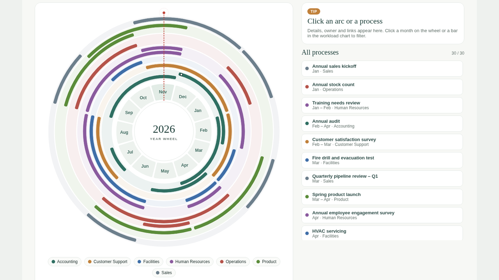

# Annual Processes Year Wheel

Builds an animated D3.js year wheel dashboard that reads a SharePoint list of annual processes live, so everyone can see what runs when across the year, who owns it, and what is coming up next. Use it on your own annual processes list, or let it set up a new list seeded with fictional sample data for a demo.

## What you get

- An HTML dashboard with one ring per department and one arc per process, from start month to end month, including processes that cross the year end
- A red today line, a "Back to today" button, drag to rotate, and a dot on processes that start within 30 days
- Filters for search, quarter, and department, plus month filtering from the wheel or the workload chart
- KPI cards for active processes, processes starting in the next 30 days, and the busiest month, a "Next up" strip, and a details panel with owner, About, Comments, and link
- A Manager workload bar chart showing how many processes run each month
- Own-data mode that maps the columns of an existing list and reports data gaps instead of changing your data
- Demo mode that creates an `Annual Processes` list and seeds 30 fictional rows for the made-up company Northwind Outfitters
- A canonical template (`references/annual-processes-wheel-template.html`) that the agent copies verbatim, so the layout, colors, and animations stay consistent

## How to use

1. Upload only the inner `annual-processes-year-wheel/` package folder (the one that contains `SKILL.md` and `references/`) to the site's Agent Assets › Skills folder. The uploaded folder name must match the `name` in `SKILL.md`.
2. Do not upload this README or `assets/` as runtime skill content.
3. In Copilot on the target SharePoint site, ask for example "build a year wheel for our Annual Processes list" or "create an annual processes dashboard".
4. If you have no list yet, ask for a demo and the skill creates and seeds the sample list first.

A live demo with the fictional sample data is at [https://anandragav.github.io/copilot-html-dashboards/annual-processes-year-wheel/](https://anandragav.github.io/copilot-html-dashboards/annual-processes-year-wheel/).

Watch the walkthrough video on YouTube: [https://youtu.be/VRtjFYBzsl4](https://youtu.be/VRtjFYBzsl4).

## About D3

The live dashboard loads D3 v7 through the page's library manifest. The template file in `references/` also works offline as a standalone sample: it tries the D3 v7 CDN first and otherwise falls back to bundled official D3 modules (ISC license) and a small selection, transition, and drag layer. The skill tells the agent not to copy the sample data, sample banner, or offline fallback code into live pages.

## SharePoint Skill

| Solution | Author(s) |
| --- | --- |
| annual-processes-year-wheel | Anand Vijayaragavan &#124; [GitHub](https://github.com/anandragav) &#124; [LinkedIn](https://www.linkedin.com/in/anand-vijayaragavan-89443012/) |

## Version history

| Version | Date | Comments |
| --- | --- | --- |
| 1.0 | November 2026 | Initial Release |

## Disclaimer

**THIS CODE IS PROVIDED _AS IS_ WITHOUT WARRANTY OF ANY KIND, EITHER EXPRESS OR IMPLIED, INCLUDING ANY IMPLIED WARRANTIES OF FITNESS FOR A PARTICULAR PURPOSE, MERCHANTABILITY, OR NON-INFRINGEMENT.**

