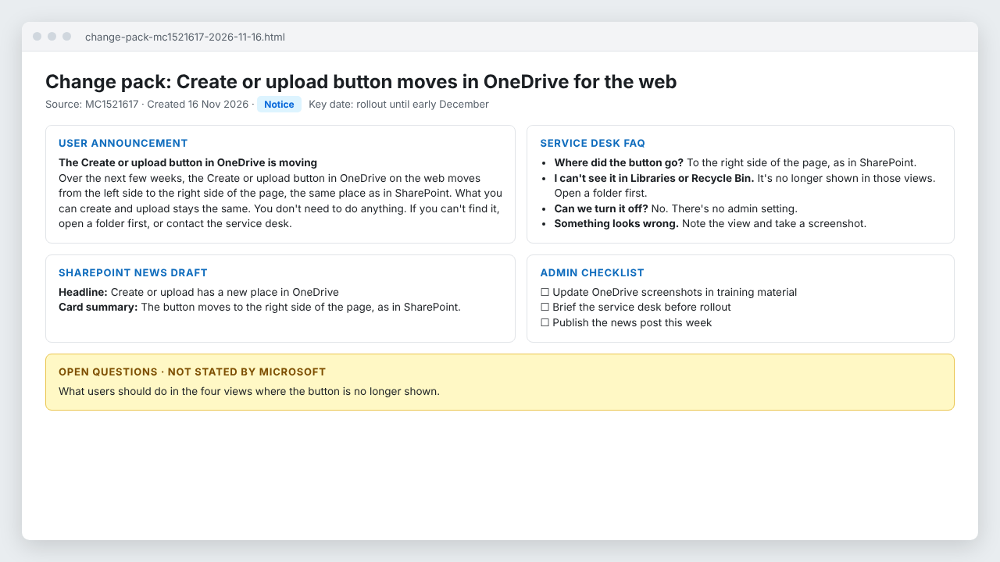

# Change Communication Pack

Turns a Microsoft 365 Message Center post, roadmap item or release note into a ready-to-use change communication pack: a user announcement, a service desk FAQ, a SharePoint news draft, an admin checklist and a list of open questions. Everything is based only on the source notice, and saved as one HTML file in the current site.

## What you get

- A confirmed fact sheet extracted from the source notice (what, who, when, admin actions)
- A classification of the change: **Notice**, **Action** or **Decision**
- A short user announcement in plain language
- A service desk FAQ with the questions users will actually ask
- A SharePoint news draft with headline, card summary and body
- An admin checklist tied to the dates in the notice
- An **Open questions** section for everything Microsoft didn't state, instead of guesses
- One self-contained HTML file saved to the site, ready to copy from

## When to use

Ask Copilot:

- "make a change pack for this message"
- "write the user announcement for MC1234567"
- "prepare service desk notes for this change"
- "turn this Message Center post into communication"

Use it every time a Message Center post affects what users see or do, so communication is consistent and quick.

## Prerequisites

- The text of the change notice, pasted in the conversation or stored as a file in the site
- Permission to create a file in a document library on the current site

## SharePoint Skill

| Solution | Author(s) |
| --- | --- |
| change-communication-pack | Knut Relbe-Moe &#124; [GitHub](https://github.com/knutrelbemoe) &#124; [LinkedIn](https://www.linkedin.com/in/knutrelbemoe/) |

## Version history

| Version | Date | Comments |
| --- | --- | --- |
| 1.0 | November 2026 | Initial Release |

## Disclaimer

**THIS CODE IS PROVIDED _AS IS_ WITHOUT WARRANTY OF ANY KIND, EITHER EXPRESS OR IMPLIED, INCLUDING ANY IMPLIED WARRANTIES OF FITNESS FOR A PARTICULAR PURPOSE, MERCHANTABILITY, OR NON-INFRINGEMENT.**

