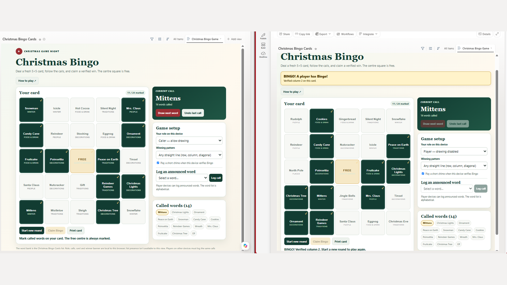
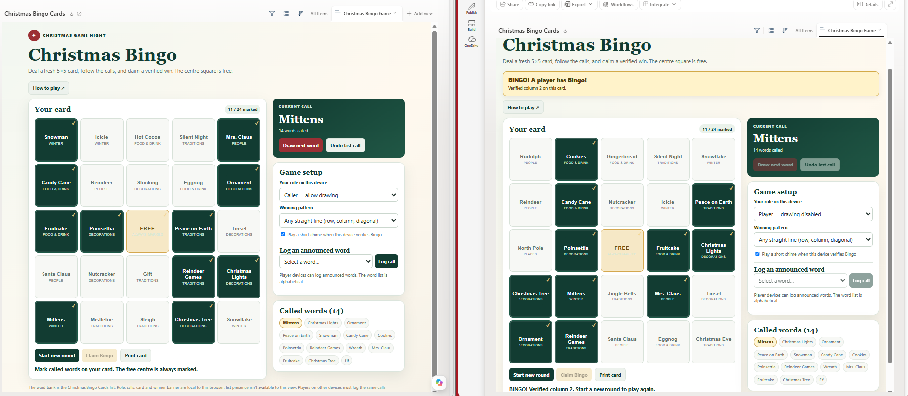
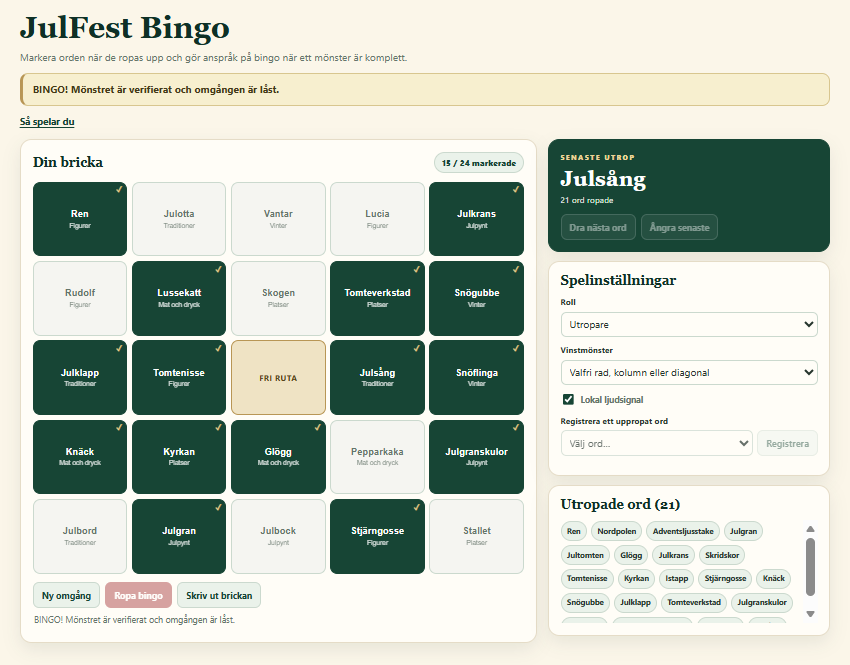

# Christmas & JulFest Bingo

Sets up a festive bingo game inside a SharePoint list. The skill creates (or repairs) an English **Christmas Bingo Cards** list and a Swedish **JulFest Bingo** list, seeds each with a 36-word themed word bank, and adds an interactive game view built from a bundled canonical template. Players get a shuffled 5×5 card, mark words as they are called, and claim a verified Bingo.

## What you get

- Two generic SharePoint lists, `Christmas Bingo Cards` (English) and `JulFest Bingo` (Swedish), with a `Bingo Word` / `Bingord` title and a `Theme` / `Tema` choice column
- 36 seeded words per list, grouped into six themes, added only when the list is empty
- A non-default HTML game view (`Christmas Bingo Game` / `JulFest Bingo`) built from the bundled template in [`christmas-julfest-bingo/assets/julfest-bingo-view-template.json`](./christmas-julfest-bingo/assets/julfest-bingo-view-template.json)
- A shuffled 5×5 card with a free centre square, a Caller/Player role switch, called-word history, undo, and an alphabetical list for logging announced words
- Win patterns for any row, column, or diagonal, four corners, or full house, with claim verification, a success banner, and confetti (skipped for reduced motion)
- SharePoint theme-aware colors, a How to play drawer, print support, and keyboard and screen reader support

## When to use

Ask Copilot:

- *"Set up Christmas and JulFest Bingo"*
- *"Create the two Christmas bingo lists and games"*
- *"Repair the Christmas Bingo or JulFest Bingo game"*
- *"Make an English or Swedish version of the bingo game"*

## How the game works on several devices

The screenshot shows the English `Christmas Bingo Game` view open in two browsers side by side. On the left, the Caller draws words (the latest call is *Mittens*, 14 words called). On the right, a Player with drawing disabled logs each announced word from the alphabetical list, marks the card, and claims Bingo; that device verifies column 2 and shows the success banner.

Each browser keeps its own card, calls, role, sound setting, and winner banner. SharePoint does not sync the game between devices, so this is not real-time multiplayer: the Caller announces each word out loud or in a meeting, and every Player logs it on their own device. The Player's Bingo appears only on that Player's screen.

The Swedish `JulFest Bingo` view looks like this after a verified claim:

## Before you upload

The bundled template contains placeholders (`https://contoso.sharepoint.com/sites/YourSite`, `{LIST-ID}`, and `/sites/YourSite/Lists/JulFest Bingo`) instead of a real site and list. The skill tells the agent to replace them with the live values of the target list before it applies the view, so you don't need to edit the file yourself.

## SharePoint Skill

| Solution | Author(s) |
| --- | --- |
| christmas-julfest-bingo | Anand Vijayaragavan &#124; [GitHub](https://github.com/anandragav) &#124; [LinkedIn](https://www.linkedin.com/in/anand-vijayaragavan-89443012/) |

## Version history

| Version | Date | Comments |
| --- | --- | --- |
| 1.0 | November 2026 | Initial Release |

## Disclaimer

**THIS CODE IS PROVIDED _AS IS_ WITHOUT WARRANTY OF ANY KIND, EITHER EXPRESS OR IMPLIED, INCLUDING ANY IMPLIED WARRANTIES OF FITNESS FOR A PARTICULAR PURPOSE, MERCHANTABILITY, OR NON-INFRINGEMENT.**

