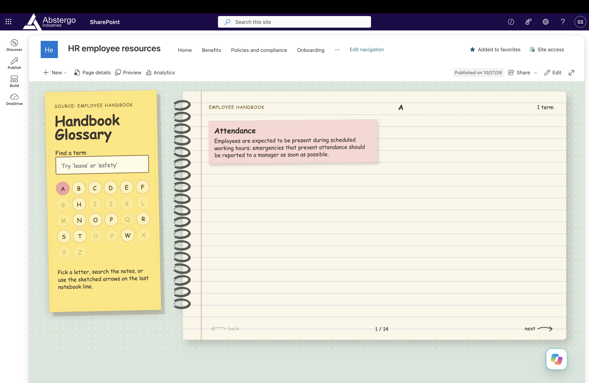

# Create Notebook Glossary

Creates a source-grounded, interactive notebook-style glossary from a SharePoint or OneDrive document, or a link supplied by the user. The finished self-contained HTML page can be saved to SharePoint.

## What you get

- Definitions based only on the source, with no invented terms or explanations
- An alphabetical glossary with searchable terms and A-Z navigation
- A handwritten layout with a sticky-note search panel, lined notebook pages, pastel term notes, and curled-wire binding
- Previous and next page arrows on the notebook's final ruled line, plus organic page-turn animation and reduced-motion support
- Self-contained vanilla HTML, CSS, and JavaScript with no external assets, fonts, or runtime dependencies

## Good to know

- For a SharePoint page, choose **New > HTML Page**, describe your idea to Copilot, and ask it to use this skill. Copilot will create the glossary in the page using this skill's notebook design, rather than saving a standalone HTML file in a document library.
- Provide a source document selected in SharePoint or OneDrive, a file URL, or another link the agent can read.
- You can optionally specify a destination HTML page or an open blank page to update.
- The notebook composition is fixed; wording, colour, and motion preferences can be applied when they don't change its layout.

## SharePoint Skill

| Solution                 | Author(s)                                                                                                     |
| ------------------------ | ------------------------------------------------------------------------------------------------------------- |
| create-notebook-glossary | Sandeep P S([GitHub](https://github.com/Sandeep-FED), [LinkedIn](https://www.linkedin.com/in/sandeepps1299/)) |

## Version history

| Version | Date         | Comments        |
| ------- | ------------ | --------------- |
| 1.0     | October 2026 | Initial Release |

## Disclaimer

**THIS CODE IS PROVIDED _AS IS_ WITHOUT WARRANTY OF ANY KIND, EITHER EXPRESS OR IMPLIED, INCLUDING ANY IMPLIED WARRANTIES OF FITNESS FOR A PARTICULAR PURPOSE, MERCHANTABILITY, OR NON-INFRINGEMENT.**

