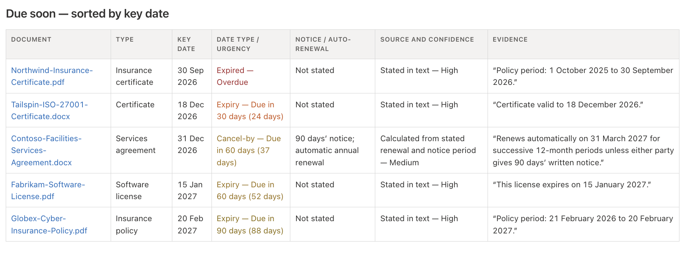

# Document Expiry & Renewal Tracker

Finds expiry, renewal, and notice-period dates in contracts, certificates, insurance documents, and policies stored in a SharePoint library, then saves a color-coded HTML report showing what is overdue or due in the next 30, 60, and 90 days, with the evidence for every date.

Contracts, certificates, and insurance policies usually carry an expiry or renewal date buried in the text, and nobody notices until it has passed. The Document Expiry & Renewal Tracker reads the documents in a library, extracts each document's dates, and shows what needs attention first. For auto-renewing agreements it also works out the cancel-by date from the notice period, which is often the date that matters most.

Every date shows where it came from (metadata, stated in text, calculated, or filename) and a confidence level, so reviewers can check it against the original. The skill never guesses: documents with no date, unreadable files, and documents with conflicting dates are listed separately for a human to review. It is strictly read-only and only saves the report.

## What you get

- Expiry, renewal, and notice-period dates extracted from contracts, certificates, insurance documents, and policies
- Cancel-by dates calculated for auto-renewing agreements from the stated notice period
- Urgency bands: Overdue, Due in 30 days, Due in 60 days, Due in 90 days, and Later; custom windows clip those ranges or add a days 91-through-window band, without overlaps or gaps
- The source of every date (metadata, stated in text, calculated, or filename), a High, Medium, or Low confidence level, and a short evidence line
- A "Needs attention" section for documents with no date, unreadable files, and documents with conflicting dates
- A self-contained HTML report saved to an Expiry Reports folder with a timestamped filename
- Strictly read-only behavior: no documents, metadata, or settings are changed and no reminders are sent

## When to use

Ask Copilot:

- "what contracts are expiring"
- "track document expiry dates"
- "which renewals are coming up"
- "find expiring certificates"
- "check upcoming renewal and notice deadlines"

## Prerequisites

- A SharePoint library or folder containing contracts, certificates, insurance documents, or policies (.pdf, .docx, .doc)
- Read access to the library and permission to create the HTML report file in a document library on the current site

## SharePoint Skill

| Solution | Author(s) |
|---|---|
| document-expiry-renewal-tracker | Manish Yadav &#124; [GitHub](https://github.com/monty0007) &#124; [LinkedIn](https://www.linkedin.com/in/manishyadav13/) |

## Version history

| Version | Date | Comments |
|---|---|---|
| 1.0 | November 2026 | Initial Release |

## Disclaimer

**THIS CODE IS PROVIDED _AS IS_ WITHOUT WARRANTY OF ANY KIND, EITHER EXPRESS OR IMPLIED, INCLUDING ANY IMPLIED WARRANTIES OF FITNESS FOR A PARTICULAR PURPOSE, MERCHANTABILITY, OR NON-INFRINGEMENT.**

