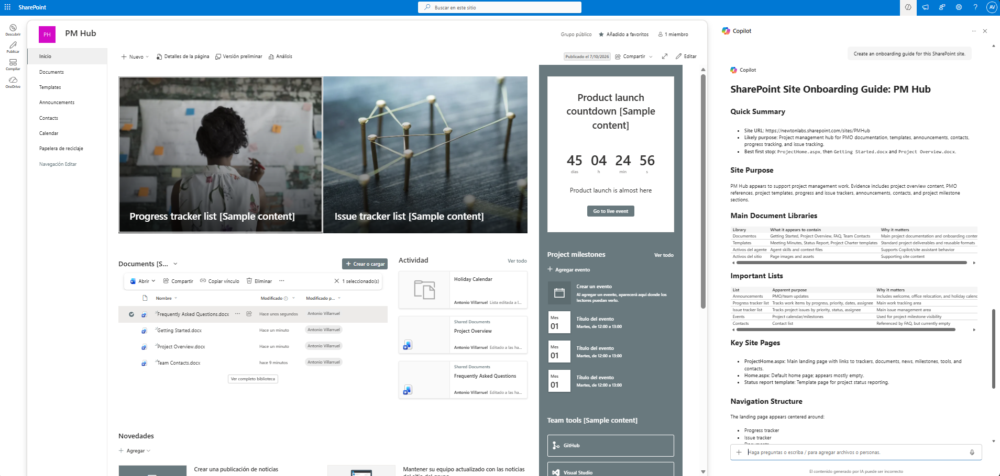

# Generate Site Onboarding Guide

Generate a professional onboarding guide for any SharePoint site in seconds.

This skill analyzes the current SharePoint site using *read-only inspection* and produces a structured Markdown guide that helps new team members quickly understand how the site is organized.

Unlike traditional documentation, the guide is generated directly from the site's observable content—including pages, document libraries, lists, navigation, and key resources—while clearly identifying anything that couldn't be determined confidently.

---

## What you get

✔️ A concise onboarding guide for new team members

✔️ Evidence-based summary of the site's purpose

✔️ Overview of important document libraries

✔️ Overview of important SharePoint lists

✔️ Identification of key pages

✔️ Navigation summary

✔️ Suggested starting points

✔️ Recommended next steps

✔️ Explicit identification of information that couldn't be determined

✔️ Read-only analysis—no SharePoint content is modified

---

## When to use

Ask Copilot things like:

- "Create an onboarding guide for this SharePoint site."
- "Help a new employee understand this site."
- "Summarize this SharePoint site."
- "What are the most important libraries?"
- "Where should a new team member start?"
- "Explain how this SharePoint site is organized."

This skill works with collaboration sites, communication sites, project sites, department sites, and team sites without requiring any custom configuration.

---

## Why it's useful

Many SharePoint sites have little or outdated documentation.

Instead of manually exploring dozens of pages, libraries, and lists, this skill provides a structured overview that helps users quickly understand:

- what the site appears to be used for;
- where important information lives;
- which resources deserve attention first;
- what remains unclear.

The guide is intentionally evidence-based and avoids making unsupported assumptions.

---

## SharePoint Skill

| Solution | Author(s) |
| --- | --- |
| generate-site-onboarding-guide | Antonio Villarruel &#124; [GitHub](https://github.com/a-villarruel) |

---

## Version history

| Version | Date | Comments |
| --- | --- | --- |
| 1.0 | October 2026 | Initial Release |

---

## Disclaimer

*THIS CODE IS PROVIDED AS IS WITHOUT WARRANTY OF ANY KIND, EITHER EXPRESS OR IMPLIED, INCLUDING ANY IMPLIED WARRANTIES OF FITNESS FOR A PARTICULAR PURPOSE, MERCHANTABILITY, OR NON-INFRINGEMENT.*

