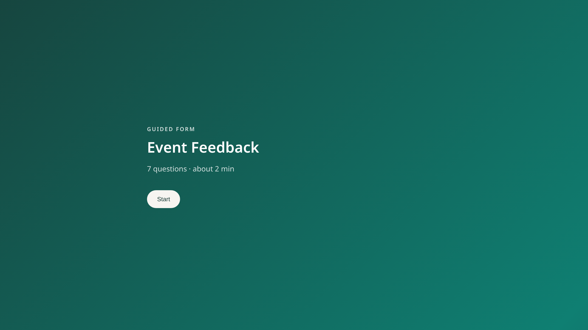
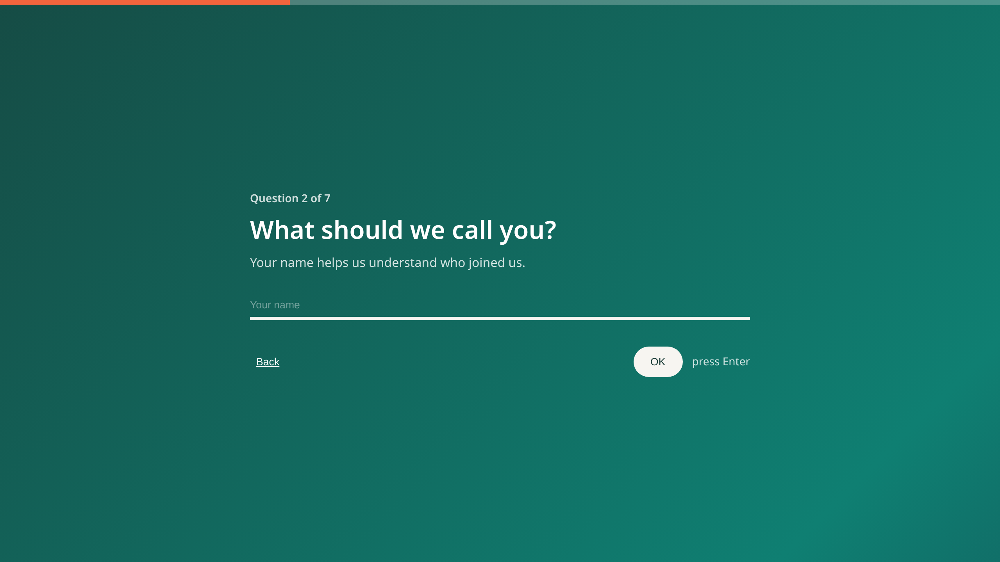
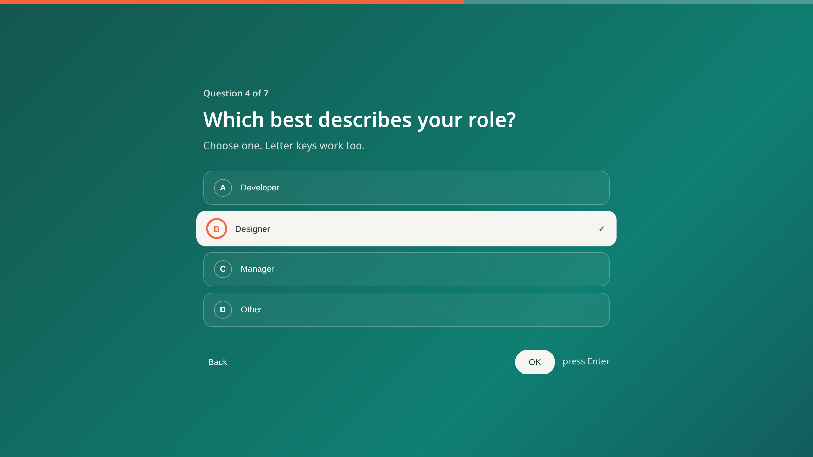
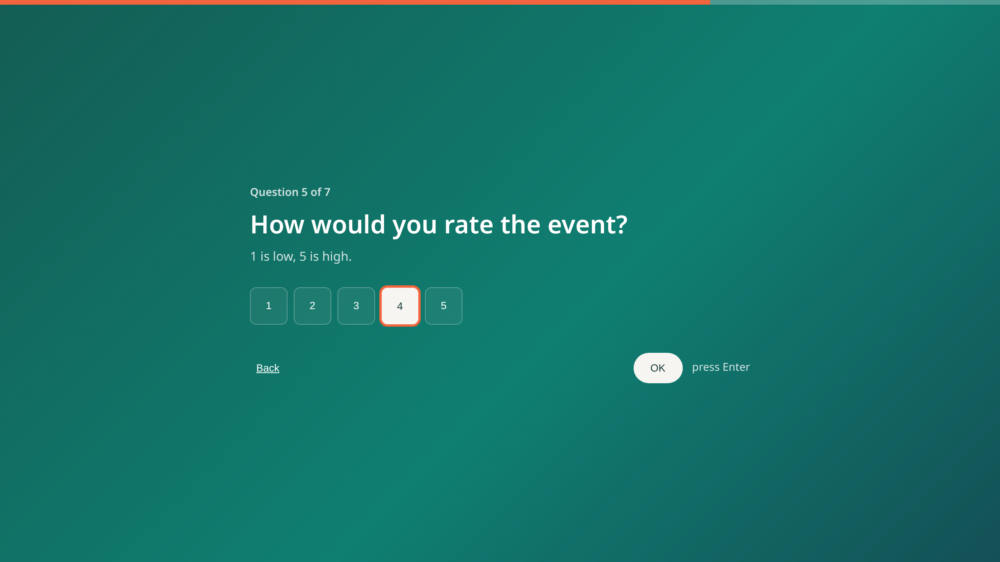
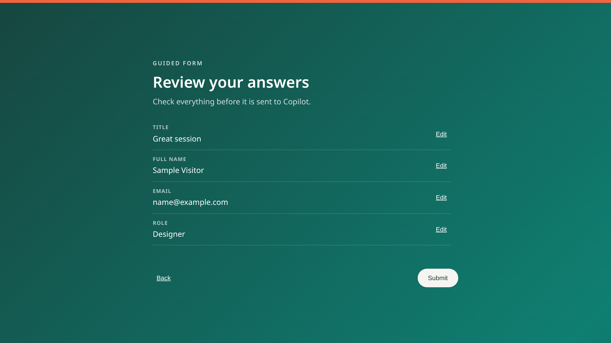
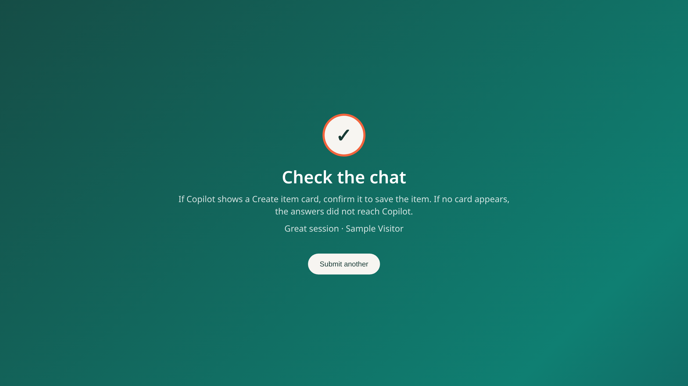
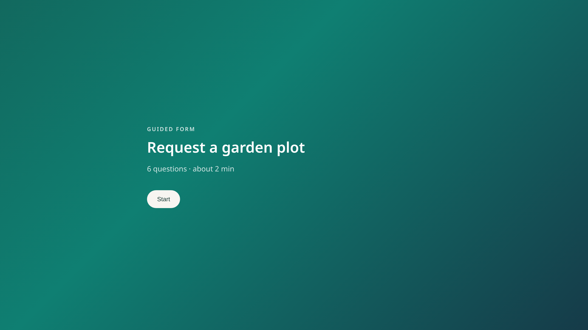

# Guided Form

A conversational, one-question-at-a-time form for a SharePoint list. Copilot in SharePoint opens it as an interactive HTML preview. Submit sends the answers back to Copilot as a chat message. The submitted answers do not include the list address. Copilot then shows an item card, and the list item is created only after the person confirms it.

## What you get

- A Guided Form in Copilot's interactive HTML preview, built from a mandatory HTML, CSS and JavaScript skeleton
- A welcome step with the list title, a padded "N questions · about N min" line, and Start
- One question at a time, with "Question N of M", a coral progress bar, underline inputs, lettered choices, rating squares, an OK cream pill, a "press Enter" hint, and a Back link
- A review step with an Edit link on every answer, compact type, and a dark glass overlay scroll bar
- A finish screen after Submit: "Check the chat", a reminder that a Create item card in chat must be confirmed to save the item, and that a missing card means the answers did not reach Copilot, plus a short summary and Submit another to start a fresh response. Nothing is written when the preview opens, and nothing is written until the person confirms the item card. If the hidden form cannot be submitted, the preview stays on the review step and shows that the form could not be sent.
- The Tech Ease palette: forest green to teal, coral for progress and selection, cream pills with dark green text
- Answers escaped as text, same-tenant https list URLs only, and no answers echoed back to the chat beyond the create call

## When to use

Ask Copilot on a SharePoint list:

- *"Open a Guided Form for this list"*
- *"Use the Guided Form skill"*
- *"Build a one-question-at-a-time HTML form for this list"*

To open the same form again later, type `/guided-list-form` or "Open a Guided Form for this list", or add a Quick Step or a Button web part that sends the same prompt. Each person who opens the form needs a Copilot license.

The skill is meant for creating one new list item. It is not a page web part and it does not edit existing items.

On a demo list in Copilot in SharePoint, Submit placed the answers in the Copilot chat and showed a Create item card. The list did not gain a row until that card was confirmed. After confirmation, Copilot reported that one item was added, and that item appeared in the list.

## Package contents

The upload-ready package is `guided-list-form/`:

- `SKILL.md`: short instructions and a copy rule for `reference.html`
- `reference.html`: the mandatory skeleton, sitting next to `SKILL.md`. Copilot should load this file and copy it byte-for-byte, replacing only `FORM_SPEC`. The sample data is Event Feedback.

Do not upload `demo/` or `assets/` with the skill package. Those stay in the outer folder for the samples gallery.

## Demo content

Open `guided-list-form/reference.html` in a browser to see the Event Feedback sample at the welcome step. Other screens from that sample, and a second fictional topic (Community garden plots), are shown below. Nothing is written to a SharePoint list from these local files.

## Video walkthrough

Watch the walkthrough on [YouTube](https://www.youtube.com/watch?v=o2iKp5pMYXs) and [Spotify](https://open.spotify.com/episode/07cPhTwyIcsbOUoZOJq9X8).

## SharePoint Skill

| Solution | Author(s) |
| --- | --- |
| guided-list-form | Anand Ragavan &#124; [GitHub](https://github.com/anandragav) &#124; [LinkedIn](https://www.linkedin.com/in/anand-v-89443012/) |

## Version history

| Version | Date | Comments |
| --- | --- | --- |
| 1.4 | November 2026 | Finish screen asks you to check the chat and does not claim the answers were delivered |
| 1.3 | November 2026 | Submit no longer sends the list address; Copilot creates the item in the list it already opened |
| 1.2 | November 2026 | Submit sends answers to Copilot as a chat message; the item is created after the person confirms the card |
| 1.1 | November 2026 | Compact skeleton in reference.html, with a short skill file that loads that file byte-for-byte |
| 1.0 | November 2026 | Initial release |

## Disclaimer

**THIS CODE IS PROVIDED _AS IS_ WITHOUT WARRANTY OF ANY KIND, EITHER EXPRESS OR IMPLIED, INCLUDING ANY IMPLIED WARRANTIES OF FITNESS FOR A PARTICULAR PURPOSE, MERCHANTABILITY, OR NON-INFRINGEMENT.**

