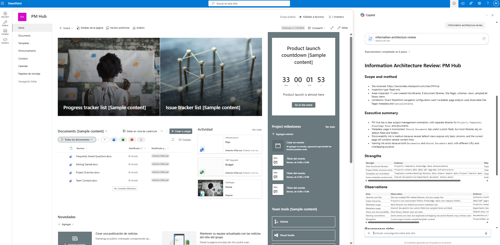

# Information Architecture Review

Well-designed information architecture helps people find information faster, improves governance, and keeps SharePoint sites scalable over time.

*Information Architecture Review* performs a read-only assessment of a SharePoint site and evaluates how information is organized across document libraries, folders, metadata, pages, and navigation.

The skill generates an evidence-based assessment with strengths, observations, governance risks, and practical recommendations—without modifying SharePoint content.

---

## What you get

- Overall Information Architecture assessment
- Review of document libraries
- Folder hierarchy analysis
- Metadata usage assessment
- Naming convention review
- Navigation structure observations
- Discoverability assessment
- Governance risks and improvement opportunities
- Prioritized recommendations based on observed evidence

---

## When to use

Ask Copilot things like:

- "Review the information architecture of this SharePoint site."
- "Evaluate how this SharePoint site is organized."
- "Analyze this site's document organization."
- "Assess the site's information architecture."
- "Review libraries, folders, and metadata."
- "Generate an information architecture assessment."
- "How well organized is this SharePoint site?"

This skill is especially useful before:

- Site redesign projects
- SharePoint migrations
- Governance initiatives
- Metadata projects
- Information architecture workshops
- Content reorganization efforts
- SharePoint health assessments

---

## Read-only by Design

This skill is intentionally *read-only*.

It never:

- Creates content
- Deletes content
- Renames files
- Moves documents
- Changes metadata
- Updates navigation
- Creates libraries
- Changes permissions
- Configures SharePoint settings

Instead, it provides an evidence-based assessment that helps site owners and administrators make informed decisions.

---

## Example Output

text
Information Architecture Assessment

Overall Rating
Moderate Maturity

Strengths
✓ Clear separation between business libraries
✓ Consistent top-level folder structure
✓ Metadata available for key content

Observations
• Deep folder hierarchy detected in Projects
• Some generic file names reduce discoverability
• Metadata adoption appears inconsistent

Recommendations
✓ Increase metadata usage
✓ Simplify deep folder structures
✓ Standardize naming conventions
✓ Review navigation to improve discoverability

---

## Why this skill?

As SharePoint sites evolve, their information architecture often becomes inconsistent.

This skill helps identify opportunities to improve:

- Organization
- Discoverability
- Scalability
- Governance
- User experience

Think of it as an *architecture review* for your SharePoint site.

---

## SharePoint Skill

| Solution | Author(s) |
| --- | --- |
| information-architecture-review | Antonio Villarruel &#124; [GitHub](https://github.com/a-villarruel) |

---

## Version history

| Version | Date | Comments |
| --- | --- | --- |
| 1.0 | November 2026 | Initial Release |

---

## Disclaimer

**THIS CODE IS PROVIDED _AS IS_ WITHOUT WARRANTY OF ANY KIND, EITHER EXPRESS OR IMPLIED, INCLUDING ANY IMPLIED WARRANTIES OF FITNESS FOR A PARTICULAR PURPOSE, MERCHANTABILITY, OR NON-INFRINGEMENT.**

