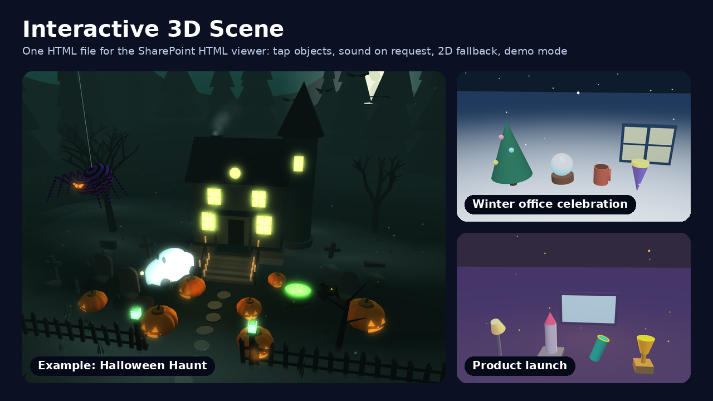

# Interactive 3D Scene

Builds a playful, clickable 3D scene as one self-contained HTML file for the SharePoint HTML viewer. The scene uses the Babylon.js library that the viewer injects, falls back to a matching 2D drawing when 3D is not available, and adds optional procedural sound, keyboard access, reduced motion support and a recording-ready demo mode. Works for seasonal greetings, team celebrations, product launches and event teasers.

## What you get

- A single `.html` file with no external files, CDNs, fonts, images or audio files
- 3 to 6 tappable objects with reactions (glow, bounce, shake, spin, flash, sparks) and short status lines
- The same reactions from buttons and number keys, announced in a live status line
- A finished SVG drawing as the fallback when the host library or WebGL is missing
- Sound that stays off until the viewer turns it on, synthesized with Web Audio
- `prefers-reduced-motion` support and a layout that works from phone to desktop
- A demo mode (`?demo=1`, optional `aspect=9x16`) that plays every reaction on a fixed timeline for screen recordings
- A starter template and six reference guides, so the pattern can be reused for any theme

## When to use

Ask Copilot:

- *"make an interactive 3D scene for our team celebration"*
- *"build a clickable seasonal page for the intranet"*
- *"create a festive scene people can tap"*
- *"make a 3D product launch page"*
- *"turn this theme into an interactive scene"*

Give a theme or occasion. Optionally name the objects, headline, colours and tone. If you do not, the skill picks objects that suit the theme and writes the text.

## Demo content

Three finished scenes are in [`demo/sample-files/`](./demo/sample-files/): a winter office celebration and a product launch built from the skill's template, and a larger Halloween Haunt example. Open them in a browser to see the output. Do not upload `demo/` with the skill package.

## SharePoint Skill

| Solution | Author(s) |
| --- | --- |
| interactive-3d-scene | Anand Vijayaraghavan &#124; [GitHub](https://github.com/anandragav) &#124; [LinkedIn](https://www.linkedin.com/in/anand-vijayaragavan-89443012/) |

## Version history

| Version | Date | Comments |
| --- | --- | --- |
| 1.0 | October 2026 | Initial Release |

## Disclaimer

**THIS CODE IS PROVIDED _AS IS_ WITHOUT WARRANTY OF ANY KIND, EITHER EXPRESS OR IMPLIED, INCLUDING ANY IMPLIED WARRANTIES OF FITNESS FOR A PARTICULAR PURPOSE, MERCHANTABILITY, OR NON-INFRINGEMENT.**

