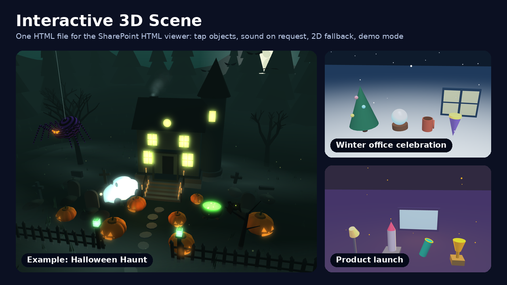

# Interactive 3D Scene

Builds a playful, clickable 3D scene as one self-contained HTML file for the SharePoint HTML viewer. Self-contained means the scene, its script, its styles and its drawn assets live in that file. Babylon.js is requested with the viewer's supported manifest, ``. When `window.BABYLON` is available and WebGL works, the page is true 3D and the camera can orbit within the scene's limits. A flat SVG with the same click and tap reactions is the fallback when the library is missing or WebGL fails, and `?mode=2d` forces that drawing when the file is opened directly. Inside SharePoint the page runs in an inner frame that does not see URL flags, so there the drawing appears only when the host does not supply Babylon.js or WebGL fails. Reduced motion, keyboard access, optional procedural sound and a recording-ready demo mode stay as they are. Works for seasonal greetings, team celebrations, product launches and event teasers.

## What you get

- A single self-contained `.html` file for SharePoint. The scene, script, styles and drawn assets are in the file. There is no CDN, font, image or audio URL, and no embedded Babylon.js build. The file requests `babylon` through the host manifest
- 3 to 6 tappable objects with reactions (glow, bounce, shake, spin, flash, sparks) and short status lines
- The same reactions from buttons and number keys, announced in a live status line
- True 3D, including camera orbit within the scene's limits, when the supported library and WebGL are available
- A finished SVG drawing as the fallback when the host library or WebGL is missing, and when `?mode=2d` is set on a directly opened file
- Sound that stays off until the viewer turns it on, synthesized with Web Audio
- `prefers-reduced-motion` support and a layout that works from phone to desktop
- A demo mode (`?demo=1`, optional `aspect=9x16`) that plays every reaction on a fixed timeline for screen recordings
- A starter template and six reference guides, so the pattern can be reused for any theme

## How the 3D library loads

- The SharePoint file uses the supported `ka-lib-manifest` loader for `babylon`. A stripped-down, bundled or inlined Babylon runtime is not required for that file.
- The page checks `window.BABYLON` and WebGL support. It does not pin a library version, and it does not assume when the host assigns `window.BABYLON`.
- A pinned CDN script, or a bundled or inlined build, is an optional compatibility route for a separate copy that has no host manifest. The SharePoint file keeps the manifest and contains no CDN URL. A public CDN does not show that an arbitrary CDN is allowed in SharePoint. See [`interactive-3d-scene/references/public-hosting.md`](./interactive-3d-scene/references/public-hosting.md).
- On 6 November 2026, I tested the original HTML scenes in SharePoint with Babylon.js loaded through ka-lib-manifest. They rendered in true 3D, with camera pan and orbit, without bundling the library into the HTML file.
- The starter and sample files keep a limited orbit with target panning disabled; that is a scene choice, not a SharePoint restriction.

## When to use

Ask Copilot:

- *"make an interactive 3D scene for our team celebration"*
- *"build a clickable seasonal page for the intranet"*
- *"create a festive scene people can tap"*
- *"make a 3D product launch page"*
- *"turn this theme into an interactive scene"*

Give a theme or occasion. Optionally name the objects, headline, colours and tone. If you do not, the skill picks objects that suit the theme and writes the text.

## Demo content

Three finished scenes are in [`demo/sample-files/`](./demo/sample-files/): a winter office celebration and a product launch built from the skill's template, and a larger Halloween Haunt example. Open them in a browser to see the output. Do not upload `demo/` with the skill package.

## SharePoint Skill

| Solution | Author(s) |
| --- | --- |
| interactive-3d-scene | Anand Vijayaragavan &#124; [GitHub](https://github.com/anandragav) &#124; [LinkedIn](https://www.linkedin.com/in/anand-vijayaragavan-89443012/) |

## Version history

| Version | Date | Comments |
| --- | --- | --- |
| 1.0 | October 2026 | Initial Release |
| 1.1 | November 2026 | Clarified the host manifest as the default Babylon.js loader and the SVG fallback. On 6 November 2026, I tested the original HTML scenes in SharePoint with Babylon.js loaded through ka-lib-manifest. They rendered in true 3D, with camera pan and orbit, without bundling the library into the HTML file. |

## Disclaimer

**THIS CODE IS PROVIDED _AS IS_ WITHOUT WARRANTY OF ANY KIND, EITHER EXPRESS OR IMPLIED, INCLUDING ANY IMPLIED WARRANTIES OF FITNESS FOR A PARTICULAR PURPOSE, MERCHANTABILITY, OR NON-INFRINGEMENT.**

