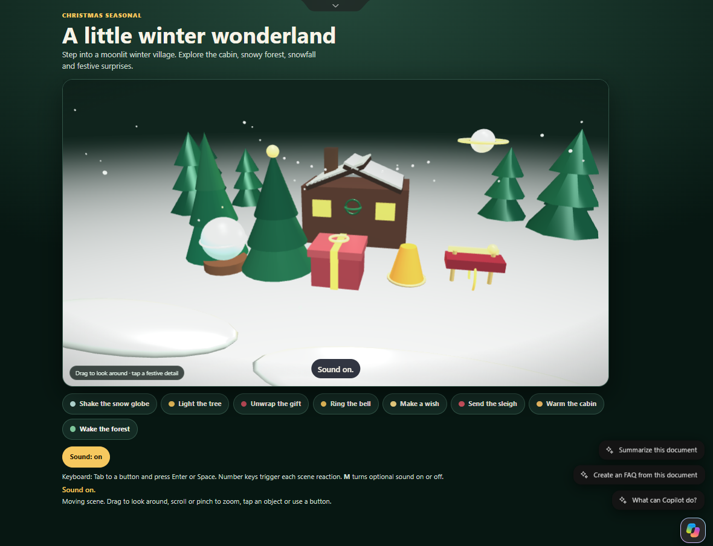
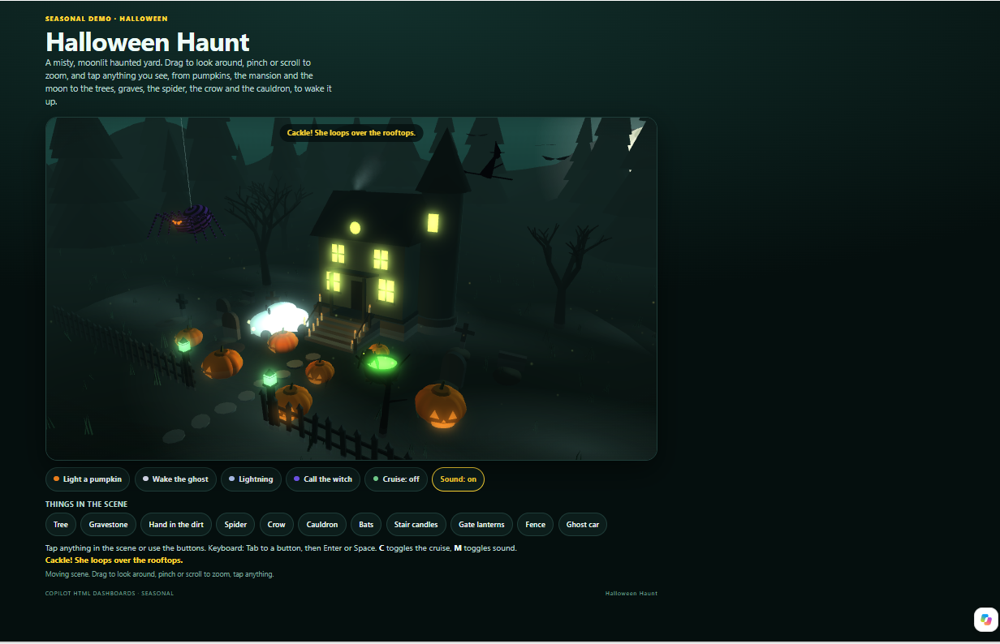

# Interactive 3D Scene — Demo Content

Finished sample output for the [interactive-3d-scene](../) skill. These files are for humans browsing GitHub. Do not upload the `demo/` folder to SharePoint Skills.

## What's included

- `sample-files/winter-office-celebration.html`: a winter office party with a tree, a snow globe, hot cocoa, a party popper and a frosty window, under falling snow. Built from the skill's starter template.
- `sample-files/product-launch.html`: a launch stage with a spotlight, a rocket, a big screen, a confetti cannon and a trophy, with rising sparkles. Built from the same template.
- `sample-files/halloween-haunt.html`: a larger, hand-tuned example with a moonlit yard, many tappable objects, a camera cruise and a demo mode. It shows how far the pattern can go. It is an example only, not a template.

Each file requests Babylon.js with `` and does not embed the library. In the SharePoint HTML viewer, a present `window.BABYLON` and working WebGL show true 3D and the scene's camera orbit. Opened straight from disk or GitHub, there is no host library, so you see the flat SVG with the same click and tap reactions. `?mode=2d` forces that drawing even when 3D is available. Reduced motion still turns movement into a glow.

On 6 November 2026, I tested the original HTML scenes in SharePoint with Babylon.js loaded through ka-lib-manifest. They rendered in true 3D, with camera pan and orbit, without bundling the library into the HTML file.

The starter and sample files keep a limited orbit with target panning disabled; that is a scene choice, not a SharePoint restriction.

## SharePoint test

I tested the skill in SharePoint on 6 November 2026. The screenshots show a winter scene and Halloween Haunt rendering in 3D.

A winter scene in the SharePoint HTML viewer. The page title is “A little winter wonderland.” This is skill output from that test. It is not identified as `sample-files/winter-office-celebration.html`.

Halloween Haunt in the SharePoint HTML viewer, rendering in 3D.

## Setup

1. Upload one HTML file to a document library such as **Site Assets** and open it in SharePoint to see the 3D version when the host library and WebGL are available, or open it in a browser to see the fallback.
2. Install the inner package `interactive-3d-scene/interactive-3d-scene/` into **Agent Assets → Skills**.
3. Ask Copilot: *"make an interactive 3D scene for our team celebration"* or *"make a 3D product launch page"*.

## Try the modes

Add these to the file URL:

- `?mode=2d` shows the drawing even when 3D is available.
- `?demo=1` plays every reaction on a timeline with the page chrome hidden. Add `&aspect=9x16` for a vertical frame and `&sound=0` for silence.

## What to expect

The skill writes one new self-contained HTML file for your theme. Self-contained means the scene, script, styles and drawn assets are in that file, and Babylon.js stays a host-manifest request. It should match the samples' structure: a scene with 3 to 6 tappable objects, buttons below it, a status line, a sound toggle and a flat SVG fallback. The objects, text and colours come from your theme, not from these samples.
