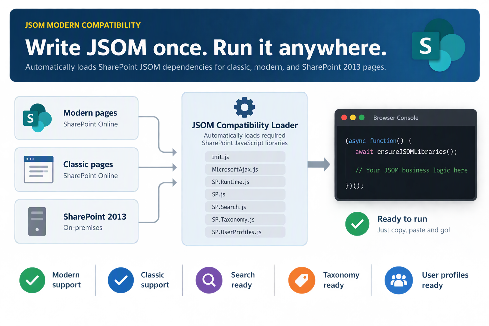

# JSOM Modern Compatibility Skill

Generates ready-to-copy JSOM scripts for SharePoint end users so they can paste one complete script into the browser developer console without worrying about JS dependency loading.

## What problem it solves
Modern SharePoint pages do not load the legacy JSOM chain by default, which causes errors such as `SP is not defined`. Classic pages, including SharePoint 2013-style pages, may already have some JSOM libraries available, but users still benefit from one compatibility-first script that works across both page types.

## What you get
- One complete ready-to-copy JavaScript script in a single code block
- Compatibility support for classic, modern, and SharePoint 2013 classic pages
- Automatic loading of required SharePoint JavaScript dependencies before business logic runs
- Support for JSOM scenarios involving lists, libraries, search, taxonomy, and user profiles
- Lightweight milestone logging suitable for browser console execution
- Delete confirmation guidance for destructive operations
- End-user run instructions and a safety warning footer

## Supported scenarios
- Classic SharePoint pages
- Modern SharePoint pages
- SharePoint 2013 classic-style JSOM usage
- JSOM for lists, libraries, search, taxonomy, user profiles, and related SharePoint client-side APIs

## Dependency strategy
Core dependency order:
- `init.js`
- `MicrosoftAjax.js`
- `SP.Runtime.js`
- `SP.js`
- `SP.Search.js`
- `SP.Taxonomy.js`
- `SP.UserProfiles.js`

The skill prefers official SharePoint documentation and Microsoft Learn guidance when shaping JSOM patterns and dependency handling.

SharePoint JavaScript files must be loaded relative to the current site URL, not from the tenant root site. For example, if the user is on `https://tenant.sharepoint.com/sites/playground`, the loader should use `https://tenant.sharepoint.com/sites/playground/_layouts/15/...`.

Additional supporting SharePoint JavaScript files are loaded only when the requested task needs them, for example:
- `sp.documentmanagement.js`
- `sp.publishing.js`
- `sp.requestexecutor.js`

## Output behavior
The skill is optimized to return:
- one short explanation;
- one complete JavaScript code block;
- short run instructions;
- one safety warning with a warning icon.

The generated code must be directly runnable in the browser console without manual cleanup. HTML-encoded operators, quotes, arrows, or comparison symbols are treated as invalid output unless the user explicitly asked for encoded text.
The skill now includes a final quality-check step before returning code so encoded output should be rewritten before the user sees it.
It also includes a renderer-safe check so encoded entities introduced by chat rendering are treated as invalid for runnable code.
A very important mandatory rule is that the rendered code block must not show HTML-encoded operators or syntax. For example, `&` must never appear as `&amp;` in runnable code.
If a clean runnable code block cannot be produced without encoding, the skill may fall back to plain text code so the user still receives unencoded runnable JavaScript.

## Logging behavior
The skill now favors lightweight logging:
- startup log
- dependency-loading logs
- execution-start log
- success summary log
- error log

It avoids excessive per-item logging unless the user explicitly asks for verbose diagnostics.

## Performance behavior
The skill also guides generated code to reduce throttling risk for large-list or resource-intensive operations by using targeted queries, row limits, paging, and safe chunking patterns.
For batching logic, it prefers official SharePoint documentation and falls back to normal JSOM implementations when batching guidance is ambiguous.

## SharePoint Skill

| Solution | Author(s) |
| --- | --- |
| jsom-modern-compatibility | Rohit Devmore &#124; [GitHub](https://github.com/rohit404404) &#124; [LinkedIn](https://www.linkedin.com/in/rohitdmore) |

## Version history

| Version | Date | Comments |
| --- | --- | --- |
| 1.0 | October 2026 | Initial Release |

## Disclaimer

**THIS CODE IS PROVIDED _AS IS_ WITHOUT WARRANTY OF ANY KIND, EITHER EXPRESS OR IMPLIED, INCLUDING ANY IMPLIED WARRANTIES OF FITNESS FOR A PARTICULAR PURPOSE, MERCHANTABILITY, OR NON-INFRINGEMENT.**

