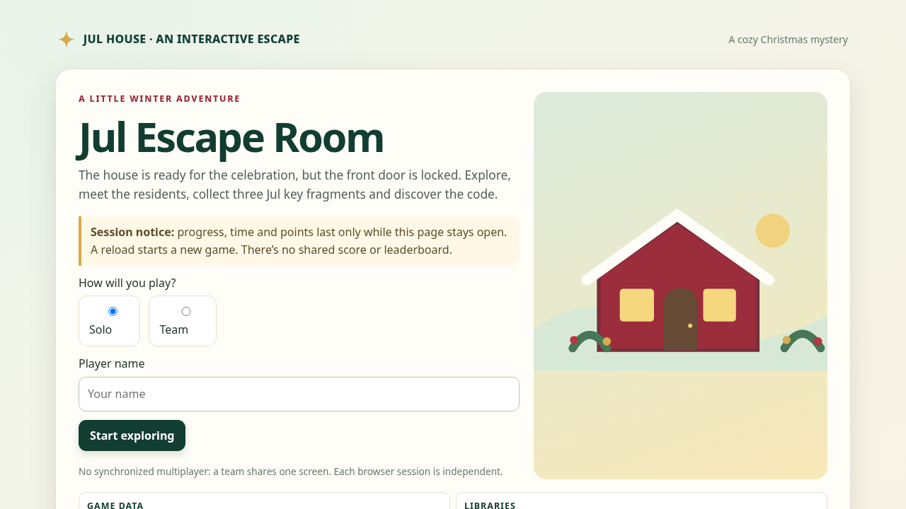

# Jul Escape Room Dashboard

Builds or repairs the Jul Escape Room SharePoint list game from a saved HTML template: a playable HTML list view plus a standalone HTML file that stay in sync with the same content list.

## What you get

- A canonical single-file HTML game template with inline CSS and SVG, system fonts only, and no external assets or network calls
- A startup prompt that creates the content list, seeds the six puzzles, and builds both playable copies
- Operating rules that keep the list as the source of live puzzle content and the saved template as the visual and interaction specification
- Default names you can override: list `Jul Escape Room Content`, view `Jul Escape Room`, document library `Reports`, and standalone file `Jul Escape Room - Play.html`
- Safe data-binding rules so list values are rendered as text, player progress is never written back to SharePoint, and both game copies stay synchronized
- Preflight and honest test-reporting rules for template fidelity, script checks, and browser behavior

## Video walkthrough

[Part 1: How I Built an Escape Room Game from a SharePoint List with Copilot](https://youtu.be/6c3yeMb44wY)

[Part 2: Copilot in SharePoint Prompt to Build an Escape Room Game](https://youtu.be/ihUqhvoDoqs) · [Listen on Spotify](https://open.spotify.com/episode/49NBCVhUM9xwX0FgLCuxC8)

## How to use

1. Upload only the inner `jul-escape-room-dashboard/` package folder (the one that contains `SKILL.md`, `references/`, and `templates/`) to a SharePoint location your agents can read, such as the site's Agent Assets › Skills folder. The uploaded folder name must match the `name` in `SKILL.md`.
2. Do not upload this README, `assets/`, or the outer repository folder as runtime skill content.
3. In Copilot on the target SharePoint site, ask to create or repair the Jul Escape Room using this skill.
4. Confirm the target site, and optionally override the default list, view, library, and standalone filename.

A public playable demo of the game is at [https://anandragav.github.io/copilot-html-dashboards/jul-escape-room/](https://anandragav.github.io/copilot-html-dashboards/jul-escape-room/).

## Check your list before you play

The game reads its puzzles from the Jul Escape Room Content list. If that list isn't right, the game stops before play and shows a red box saying what is wrong. It never quietly swaps in the sample puzzles. Check these points first:

- **Exactly six active rows.** IsActive must be Yes on all six. Five or seven active rows stop the game.
- **Every column filled in and included in the view.** The view behind the game must include every column the game reads: Title, PuzzleId, Room, RoomTitle, RoomDescription, RoomRequiresItemIds, RoomNpcName, RoomNpcGreeting, RoomNpcItemLine, ObjectLabel, PuzzleType, Question, Choices, AcceptedAnswers, Hint, NudgeText, SuccessText, RetryText, RequiresItemIds, RewardItemId, RewardItemName, RewardItemDescription, RewardExtraItems, PointsValue, SortOrder, IsFinalPuzzle and IsActive. The reward columns can be empty only on the final puzzle.
- **Valid JSON in the five JSON columns.** RoomRequiresItemIds, Choices, AcceptedAnswers, RequiresItemIds and RewardExtraItems must each hold a JSON array, even when it's empty: `[]`. A missing bracket or quote stops the game.
- **Answers that match.** For a choice puzzle, every value in AcceptedAnswers must be one of the `id` values in Choices, such as `["env2"]`.
- **One final puzzle.** IsFinalPuzzle is Yes on exactly one row.
- **Items that exist.** Every item ID in RoomRequiresItemIds or RequiresItemIds must be the RewardItemId of another row, or a room can never be opened.
- **Unique IDs.** No two rows share a PuzzleId.

Text in the list is always shown as plain text, so `<b>` or other markup in a choice or answer appears as typed, not as formatting.

### What the messages mean

| Message | What to fix |
| --- | --- |
| The puzzle list has 5 rows; the game needs 6. | Add or reactivate rows until exactly six have IsActive set to Yes. |
| Row 3 is missing field Question. | Fill in that column, and make sure the view includes it. |
| Row 2: Choices could not be parsed. | Fix the JSON in that cell, for example a missing `]` or `"`. |
| Row 2: Choices must be a JSON array. | Wrap the value in `[ ]`. |
| RECIPE has an accepted answer that is not a choice ID. | Make AcceptedAnswers use the `id` values from Choices. |
| Exactly one active final puzzle is required. | Set IsFinalPuzzle to Yes on one row and No on the rest. |
| BOOKS requires unknown item BRASS_KEY. | Check the spelling against the RewardItemId that hands out that item. |
| BOOKS is unreachable from the initially open rooms. | Make sure the item that opens the room is a reward in a room the player can reach. |
| Duplicate PuzzleId: BOOKS | Give each row its own PuzzleId. |

The diagnostics panel shows where the puzzles came from. "Live list rows loaded: 6." means the game is reading your list. "Bundled sample data (standalone copy; list not connected here)." means the list couldn't be reached, for example in a downloaded copy of the file, so the built-in sample is being played instead.

## SharePoint Skill

| Solution | Author(s) |
| --- | --- |
| jul-escape-room-dashboard | Anand Vijayaragavan &#124; [GitHub](https://github.com/anandragav) &#124; [LinkedIn](https://www.linkedin.com/in/anand-vijayaragavan-89443012/) |

## Version history

| Version | Date | Comments |
| --- | --- | --- |
| 1.0 | November 2026 | Initial Release |

## Disclaimer

**THIS CODE IS PROVIDED _AS IS_ WITHOUT WARRANTY OF ANY KIND, EITHER EXPRESS OR IMPLIED, INCLUDING ANY IMPLIED WARRANTIES OF FITNESS FOR A PARTICULAR PURPOSE, MERCHANTABILITY, OR NON-INFRINGEMENT.**

