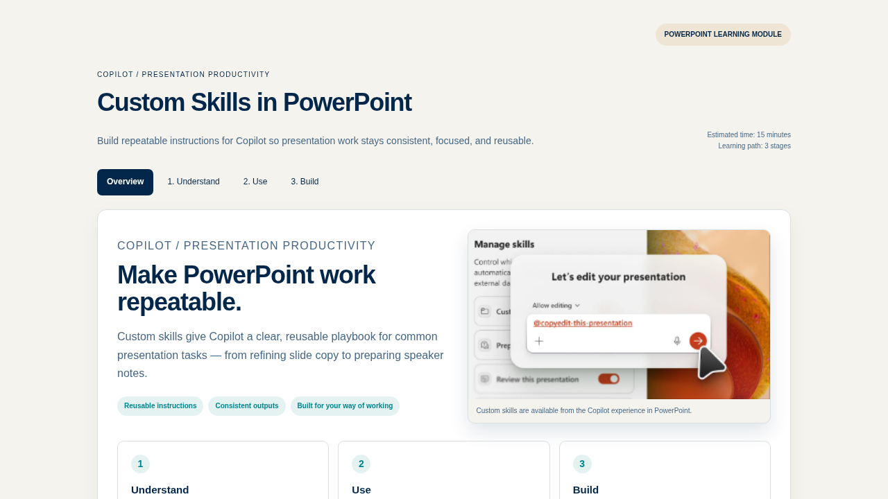

# Learning Designer

Turns a filled Learning Request Brief (a .docx generated from a SharePoint Structured Document Generation form) into a single self-contained HTML learning dashboard with up to 3 stages, flashcards, practice and checks. Content comes from the brief; the layout and visual system come from the reference dashboard bundled with the skill.

## What you get

- One self-contained `.html` learning dashboard (inline styles, SVGs and script, embedded image, no external assets or libraries), typically 40–70 KB
- A hero with the topic, audience, goals and a duration chip (if supplied)
- A learning-path rail with exactly the stages in the brief (1–3), and one section per stage using Why / When / How / Check blocks for procedural content
- CSS flip-card decks built from the brief's flashcard concepts and knowledge checks, flipping on hover and keyboard focus
- A practice exercise with success criteria, a "Take it further" next-steps section and a footer with owner and source notes
- An optional overview visual: a `learning-visual.png` (or `.jpg`) in the same folder as the brief is embedded as a base64 data URI; if it is missing, the image is omitted
- Content grounded in the brief's authoritative source when one is given, with unverified details marked by a visible amber warning callout
- A short plain-language summary of what was built and any gaps left for the owner

## When to use

Ask Copilot:

- *"build the learning dashboard from this brief"*
- *"turn this brief into a learning experience"*
- *"design the page for this topic"*

Select or attach a Learning Request Brief .docx generated from the form first. The skill is not meant for plain articles or support pages without stages, general slide decks, or topics that need more than 3 stages.

## Form → Brief → Dashboard flow

1. Upload `learning-request-brief-template.docx` (in [`demo/sample-files/`](./demo/sample-files/)) to a SharePoint library and create a Structured Document Generation form from it.
2. Share the form. Required fields: LearningTopic, TargetAudience, LearningGoals and the three stage sets (Stage*N*Name, Stage*N*Description, Stage*N*KeyPoints).
3. Each submission produces a filled Learning Request Brief .docx.
4. Select or attach the brief and invoke the Learning Designer skill.
5. Save the HTML file, upload it to a SharePoint document library, and open it from there. Don't paste it into a SharePoint text web part: text web parts remove the page's styles and script, so the layout, tabs and quizzes stop working.

## Package contents

The upload-ready package is `learning-designer/`:

- `SKILL.md` — instructions
- `mapping/mapping.md` — field-to-dashboard-component mapping, image handling and constraints
- `references/test-output-custom-skills.html` — the reference dashboard ("Custom Skills in PowerPoint") that defines the layout, class names and visual system

## Demo content

The Word template and a filled sample brief are in [`demo/sample-files/`](./demo/sample-files/). Do not upload `demo/` with the skill package.

## SharePoint Skill

| Solution | Author(s) |
| --- | --- |
| learning-designer | Anand Ragavan &#124; [GitHub](https://github.com/anandragav) &#124; [LinkedIn](https://www.linkedin.com/in/anand-v-89443012/) |

## Version history

| Version | Date | Comments |
| --- | --- | --- |
| 1.0 | October 2026 | Initial Release |

## Disclaimer

**THIS CODE IS PROVIDED _AS IS_ WITHOUT WARRANTY OF ANY KIND, EITHER EXPRESS OR IMPLIED, INCLUDING ANY IMPLIED WARRANTIES OF FITNESS FOR A PARTICULAR PURPOSE, MERCHANTABILITY, OR NON-INFRINGEMENT.**

