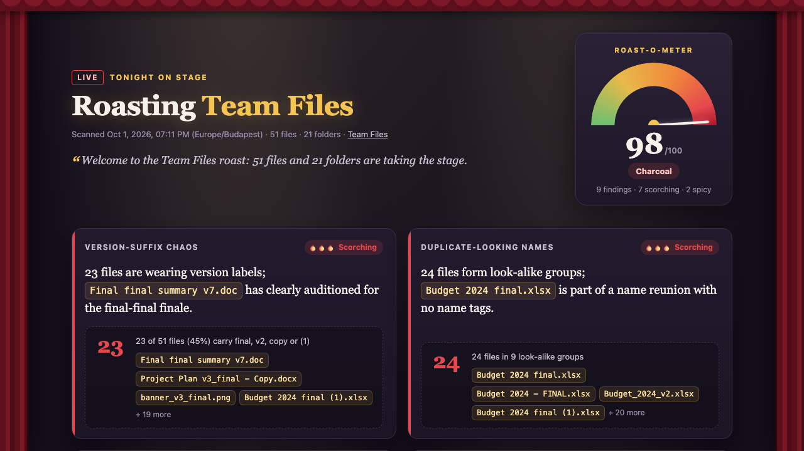

# Library Roast

This skill writes a comedy roast of one SharePoint document library and ends it with a cleanup plan. Each joke is based on a measured finding and quotes the real count and a real file name. The cleanup plan is serious and in priority order.

It checks for version suffixes (`final`, `FINAL`, `v2`, `v3_final`, `copy`, `(1)`), duplicate-looking names, files nobody has touched in two years, deep folder nesting, empty folders, very large files, inconsistent naming and date formats, files at the library root, and legacy Office formats (`.doc`, `.xls`, `.ppt`). The jokes are about files and folders. The skill doesn't read or mention authors or editors.

The skill is read-only. It doesn't change the library and doesn't offer to. It writes one file, the roast, by default to a `Reports` library. If that library doesn't exist, the skill asks before creating it.

It finds the same kinds of problems that `library-cleanup`, `analyze-document-library`, and `sync-blocker-auditor` report or fix. The roast is meant as a read-only page to share at the start of a cleanup workshop. It scores the findings and points each one to the skill that fixes it.

The roast reads up to 5,000 files and folders in one run. In a larger library it roasts the first 5,000 items, says so under "Not checked", skips the empty-folder check, and lists no check as passed. Copilot runs the skill's scripts in its plan runtime and takes every count from them.

## What you get

- An HTML page (the "roast stage") saved as `Library-roast-<library>-<date>-<time>.html` with:
  - A Roast-o-meter score from 0 to 100, with labels from "Nothing to roast" to "Charcoal"
  - One roast card per finding: the joke, the evidence (count, share of the library, and example file names), and a severity of Mild, Spicy, or Scorching
  - "The serious part": a cleanup plan in priority order. It points to skills that can do the work, such as `library-cleanup`, `organize-library`, `rename-files-date-prefix`, and `metadata-completeness-auditor`, and lists manual steps where no skill fits.
  - A note on how each finding was measured
- A short chat summary with the score, the best jokes, and the cleanup plan
- A "nothing to roast" page with score 0 when the library is tidy
- If you ask in another language, the jokes, labels, and plan are written in that language

Example prompts:

- "Roast this document library"
- "Roast the Team Files library and save it in Reports"
- "How bad is our Projects library? Be funny about it, then tell me how to fix it"

## SharePoint Skill

| Solution | Author(s) |
| --- | --- |
| library-roast | Kornél Felföldi &#124; [GitHub](https://github.com/xenophobentx) |

## Version history

| Version | Date | Comments |
| --- | --- | --- |
| 1.0 | November 2026 | Initial Release |

## Disclaimer

**THIS CODE IS PROVIDED _AS IS_ WITHOUT WARRANTY OF ANY KIND, EITHER EXPRESS OR IMPLIED, INCLUDING ANY IMPLIED WARRANTIES OF FITNESS FOR A PARTICULAR PURPOSE, MERCHANTABILITY, OR NON-INFRINGEMENT.**

