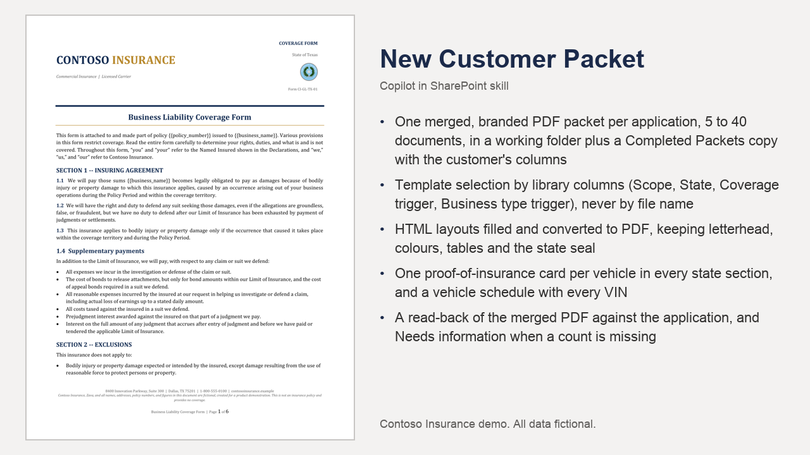

# New Customer Packet

Builds a complete, branded new-customer insurance packet from one application PDF, selected by library metadata and rendered from HTML layouts.

## What you get

- One merged, branded PDF packet per application, 5 to 40 documents, in a working folder plus a Completed Packets copy with the customer's columns
- Template selection by library columns (Scope, State, Coverage trigger, Business type trigger), never by file name
- HTML layouts filled and converted to PDF, keeping letterhead, colours, tables and the state seal
- One proof-of-insurance card per vehicle in every state section, and a vehicle schedule with every VIN
- A read-back of the merged PDF against the application, and Needs information when a count is missing
- A rulebook in references/ that a business owner edits instead of the skill

Full demo, sample files, HTML layouts and setup: [https://github.com/HassanJMoses/copilot-sharepoint-demos](https://github.com/HassanJMoses/copilot-sharepoint-demos)

Watch it run: [Copilot in SharePoint for Insurance (video)](https://www.youtube.com/watch?v=xFWDL-QakWM)

## Install

Upload the inner `new-customer-packet/` folder (SKILL.md and references/) into the site's **Agent Assets › Skills** folder. The folder name must match the `name` in SKILL.md. Open the Copilot pane and type `/` to see it.

This skill names its libraries by full address. Before uploading, replace `https://YOUR-TENANT.sharepoint.com/sites/YOUR-SITE` in SKILL.md with your site address. The libraries and columns it expects are listed in the demo repository's setup guide.

## SharePoint Skill

| Solution | Author(s) |
| --- | --- |
| new-customer-packet | Hassan Moses &#124; [GitHub](https://github.com/HassanJMoses) |

## Version history

| Version | Date | Comments |
| --- | --- | --- |
| 1.0 | October 2026 | Initial release |

## Disclaimer

**THIS CODE IS PROVIDED _AS IS_ WITHOUT WARRANTY OF ANY KIND, EITHER EXPRESS OR IMPLIED, INCLUDING ANY IMPLIED WARRANTIES OF FITNESS FOR A PARTICULAR PURPOSE, MERCHANTABILITY, OR NON-INFRINGEMENT.**

All companies, people, policy numbers and figures in the sample files are fictional, created for a product demonstration.

