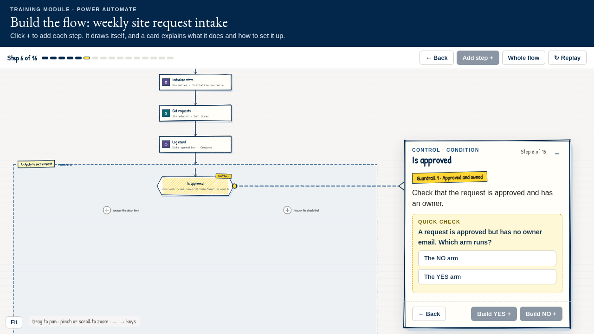

# Power Automate documentation and training

Turns a Power Automate cloud flow export into one interactive, hand-drawn training page for SharePoint. The learner clicks + to build the flow the way they would in the designer: each step draws itself in, a card anchored to the step explains what it does, why it is there, and how to set it up, quick checks sit on the real guardrails, and a finish screen sums up the lessons with a doughnut checklist.

## What you get

- One SharePoint-ready `.html` file: inline style and script, D3 and Chart.js supplied by SharePoint through `ka-lib-manifest`, nothing bundled or loaded from a CDN, no network calls, and no storage
- The flow's real structure from the export: the trigger, every action in run order, Apply to each and Do until boxes, Condition and Switch arms, scopes, and error paths
- A what / why / how card for every step, with the why linked to the previous step, the next step, and the goal of the flow
- Quick checks on two or three guardrails; the next step stays locked until the learner answers
- Loop and data animations where they teach something: the Do until loop-back, items fanning into Apply to each, data moving into a step
- A finish screen with the guardrails and a checklist doughnut
- Masking before anything is written: tenant URLs, personal site paths, emails, list and connection IDs, keys, and tokens are replaced with fictional values the user approves
- A data check: if the generated data is incomplete (an empty field, a quiz without exactly one right answer, a step before its parent), the page lists the problems instead of running, and never falls back to the sample flow
- A plain-text fallback when the libraries are not available, keyboard controls (Tab, Enter, arrow keys, Escape), reduced motion that also follows a change made while the page is open, and a bottom-sheet card on phones. Screen readers, high contrast, and zoom have not been tested yet

## How it works

1. Export the flow: **My flows > Export > Package (.zip)**, a solution `.zip`, or a `definition.json`. In Copilot in SharePoint, upload the zip to a document library on the site and paste its link into the chat. Copilot reads the export, masks sensitive values, and fills the bundled template.
2. Copilot plays back the whole flow in one message: the trigger, each action in plain words, the goal and audience it inferred, and the guardrails it spotted. Correct anything by number in one reply.
3. Copilot shows the masking table in the same chat. Approve it or edit it.
4. Copilot asks only for what the export cannot tell it: the reasons behind key steps, gotchas, which guardrails to quiz, and any test evidence.
5. Copilot fills the bundled template and saves the page as an `.html` file in the site. SharePoint may add its own theme styles around it; the page keeps its own look. Open the file from the library or Site Pages. Do not paste it into a text web part.

## Package contents

The upload-ready package is `power-automate-documentation-and-training/`:

- `SKILL.md`: instructions
- `templates/flow-training-template.html`: the page engine with a small sample data block
- `references/`: export formats, the chat playback and an example dialog, guardrail patterns, masking rules, card writing, the handoff file, the data block, sandbox rules, and the optional public copy

## Local tools

Parser, page builder, tests, and the fictional sample export live in a companion repo: COMPANION_REPO_URL

## SharePoint Skill

| Solution | Author(s) |
| --- | --- |
| power-automate-documentation-and-training | Anand Vijayaragavan &#124; [GitHub](https://github.com/anandragav) &#124; [LinkedIn](https://www.linkedin.com/in/anand-v-89443012/) |

## Version history

| Version | Date | Comments |
| --- | --- | --- |
| 1.0 | November 2026 | Initial Release |

## Disclaimer

**THIS CODE IS PROVIDED _AS IS_ WITHOUT WARRANTY OF ANY KIND, EITHER EXPRESS OR IMPLIED, INCLUDING ANY IMPLIED WARRANTIES OF FITNESS FOR A PARTICULAR PURPOSE, MERCHANTABILITY, OR NON-INFRINGEMENT.**

