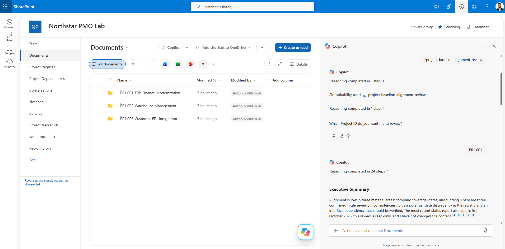

# Project Baseline Alignment Review

Review project baseline documents and SharePoint portfolio records to identify inconsistencies, gaps, and potential alignment issues across scope, schedule, budget, deliverables, governance, and dependencies.

## What you get

- Evidence-based comparison of a project charter, scope statement, schedule, budget, and latest status report.
- Cross-checks against structured SharePoint `Project Register` and `Project Dependencies` lists.
- Consistent classification of findings as **Confirmed Inconsistency**, **Potential Issue**, **Information Gap**, or **Change Control Gap**.
- Severity ratings and prioritized recommended actions.
- Traceable source references, with explicit handling of missing or inaccessible information.
- Read-only operation: the skill does not modify SharePoint content.

## Example use cases

- Validate whether the approved scope and deployment plan describe the same release.
- Compare approved completion dates with schedule forecasts and portfolio reporting.
- Reconcile funding envelopes, detailed cost baselines, and forecast costs.
- Identify missing evidence of formal change-control decisions.
- Assess whether a cross-project dependency may affect a project commitment.

## Prerequisites

The skill is designed for a SharePoint environment with:

- A document library containing project folders organized by Project ID.
- A `Project Register` list containing project ownership, status, health, dates, and financial information.
- Optionally, a `Project Dependencies` list containing cross-project dependency records.

The skill can review whichever sources are available to the user. Missing or inaccessible sources are reported as limitations rather than assumed to exist.

## How to use

1. Add the skill to the intended SharePoint or Microsoft 365 Copilot environment.
2. Grant it access only to the SharePoint locations and lists it needs to review.
3. Provide a Project ID, for example `PRJ-001`.
4. Ask it to perform a Project Baseline Alignment Review.
5. Review the findings and validate any proposed action through the organization's normal project governance process.

## Example prompt

> Perform a Project Baseline Alignment Review for PRJ-001. Review the available project documents and corresponding Project Register and Project Dependencies records. Identify confirmed inconsistencies, potential issues, information gaps, and change-control gaps. Provide evidence for each finding and generate the complete structured report.

## SharePoint Skill

| Solution | Author(s) |
|---|---|
| project-baseline-alignment-review | Antonio Villarruel &#124; [GitHub](https://github.com/a-villarruel) |

## Version history

| Version | Date | Comments |
| --- | --- | --- |
| 1.0 | November 2026 | Initial Release |

## Disclaimer

**THIS CODE IS PROVIDED _AS IS_ WITHOUT WARRANTY OF ANY KIND, EITHER EXPRESS OR IMPLIED, INCLUDING ANY IMPLIED WARRANTIES OF FITNESS FOR A PARTICULAR PURPOSE, MERCHANTABILITY, OR NON-INFRINGEMENT.**

