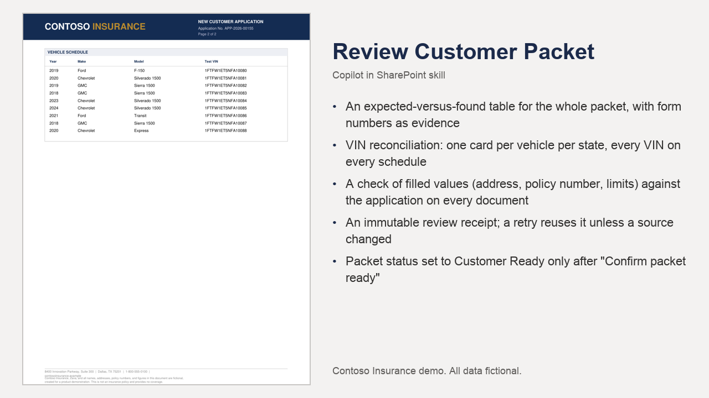

# Review Customer Packet

Reviews a completed customer packet against its application and the packet rulebook, reconciles every VIN, and sets Customer Ready only after the reviewer confirms.

## What you get

- An expected-versus-found table for the whole packet, with form numbers as evidence
- VIN reconciliation: one card per vehicle per state, every VIN on every schedule
- A check of filled values (address, policy number, limits) against the application on every document
- An immutable review receipt; a retry reuses it unless a source changed
- Packet status set to Customer Ready only after "Confirm packet ready"

Full demo, sample files, HTML layouts and setup: [https://github.com/HassanJMoses/copilot-sharepoint-demos](https://github.com/HassanJMoses/copilot-sharepoint-demos)

Watch it run: [Copilot in SharePoint for Insurance (video)](https://www.youtube.com/watch?v=xFWDL-QakWM)

## Install

Upload the inner `review-customer-packet/` folder (SKILL.md and references/) into the site's **Agent Assets › Skills** folder. The folder name must match the `name` in SKILL.md. Open the Copilot pane and type `/` to see it.

This skill names its libraries by full address. Before uploading, replace `https://YOUR-TENANT.sharepoint.com/sites/YOUR-SITE` in SKILL.md with your site address. The libraries and columns it expects are listed in the demo repository's setup guide.

## SharePoint Skill

| Solution | Author(s) |
| --- | --- |
| review-customer-packet | Hassan Moses &#124; [GitHub](https://github.com/HassanJMoses) |

## Version history

| Version | Date | Comments |
| --- | --- | --- |
| 1.0 | October 2026 | Initial release |

## Disclaimer

**THIS CODE IS PROVIDED _AS IS_ WITHOUT WARRANTY OF ANY KIND, EITHER EXPRESS OR IMPLIED, INCLUDING ANY IMPLIED WARRANTIES OF FITNESS FOR A PARTICULAR PURPOSE, MERCHANTABILITY, OR NON-INFRINGEMENT.**

All companies, people, policy numbers and figures in the sample files are fictional, created for a product demonstration.

