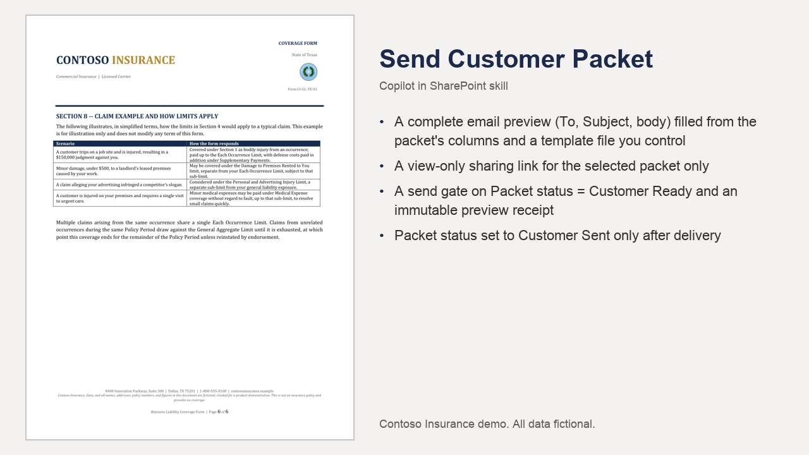

# Send Customer Packet

Prepares and sends the customer packet email with a view-only link, gated on Packet status and an explicit confirmation of the exact preview.

## What you get

- A complete email preview (To, Subject, body) filled from the packet's columns and a template file you control
- A view-only sharing link for the selected packet only
- A send gate on Packet status = Customer Ready and an immutable preview receipt
- Packet status set to Customer Sent only after delivery

Full demo, sample files, HTML layouts and setup: [https://github.com/HassanJMoses/copilot-sharepoint-demos](https://github.com/HassanJMoses/copilot-sharepoint-demos)

Watch it run: [Copilot in SharePoint for Insurance (video)](https://www.youtube.com/watch?v=xFWDL-QakWM)

## Install

Upload the inner `send-customer-packet/` folder (SKILL.md) into the site's **Agent Assets › Skills** folder. The folder name must match the `name` in SKILL.md. Open the Copilot pane and type `/` to see it.

This skill reads `Email templates/customer-packet-email.md` from the site's Documents library and needs the Completed Packets columns described in the demo repository's setup guide.

## SharePoint Skill

| Solution | Author(s) |
| --- | --- |
| send-customer-packet | Hassan Moses &#124; [GitHub](https://github.com/HassanJMoses) |

## Version history

| Version | Date | Comments |
| --- | --- | --- |
| 1.0 | October 2026 | Initial release |

## Disclaimer

**THIS CODE IS PROVIDED _AS IS_ WITHOUT WARRANTY OF ANY KIND, EITHER EXPRESS OR IMPLIED, INCLUDING ANY IMPLIED WARRANTIES OF FITNESS FOR A PARTICULAR PURPOSE, MERCHANTABILITY, OR NON-INFRINGEMENT.**

All companies, people, policy numbers and figures in the sample files are fictional, created for a product demonstration.

