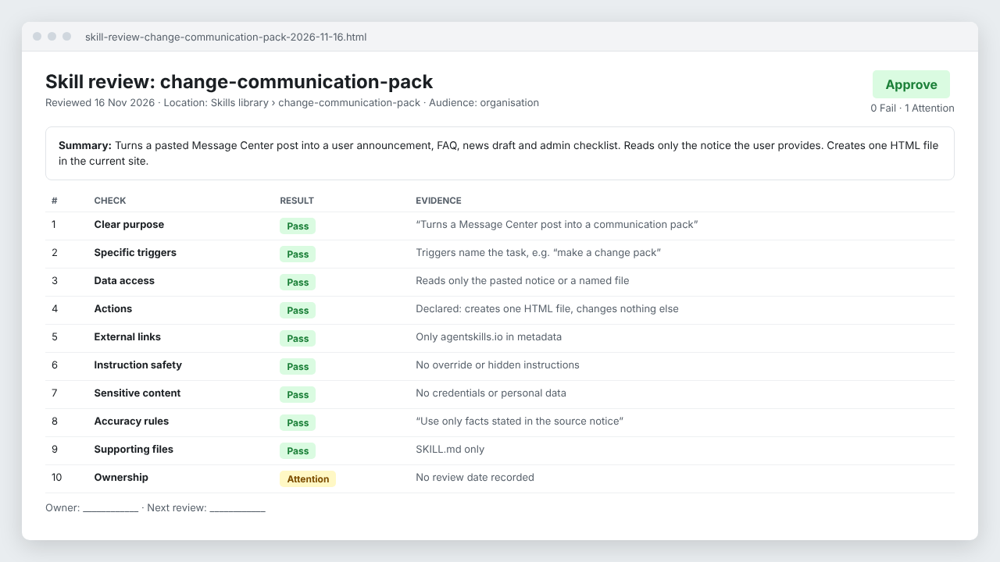

# Skill Review Checklist

Reviews a Copilot or SharePoint skill package before it is shared more widely. Checks the SKILL.md and its files against a ten-point governance checklist covering purpose, triggers, data access, actions, external links, instruction safety, sensitive content and ownership, and saves a review record with a clear recommendation: approve, revise or reject.

## What you get

- A plain-language summary of what the skill does, reads and changes
- A ten-point checklist with **Pass**, **Attention** or **Fail** for each item, quoting the text that led to the result
- Flags for broad trigger phrases that can make automatic use pick the skill too often
- Flags for undeclared write actions, external links and instructions that try to override Copilot's behaviour
- An overall recommendation, with the exact changes needed to reach **Approve**
- A self-contained HTML review record saved next to the skill, with fields for owner and next review date
- Strictly read-only behaviour: the reviewed skill is never changed, shared or deleted

## When to use

Ask Copilot:

- "review this skill"
- "is this skill safe to share"
- "skill governance review"
- "prepare this skill for the corporate catalog"

Use it when a personal or team skill is about to be shared with a larger audience, as part of a regular review of skills in a library, or before adding a skill to an organisation-wide catalog.

## Prerequisites

- A skill folder with a `SKILL.md` file in a SharePoint document library, or the skill text pasted into the conversation
- Read access to the skill files
- Permission to create the review file in a document library on the current site

## SharePoint Skill

| Solution | Author(s) |
| --- | --- |
| skill-review-checklist | Knut Relbe-Moe &#124; [GitHub](https://github.com/knutrelbemoe) &#124; [LinkedIn](https://www.linkedin.com/in/knutrelbemoe/) |

## Version history

| Version | Date | Comments |
| --- | --- | --- |
| 1.0 | November 2026 | Initial Release |

## Disclaimer

**THIS CODE IS PROVIDED _AS IS_ WITHOUT WARRANTY OF ANY KIND, EITHER EXPRESS OR IMPLIED, INCLUDING ANY IMPLIED WARRANTIES OF FITNESS FOR A PARTICULAR PURPOSE, MERCHANTABILITY, OR NON-INFRINGEMENT.**

