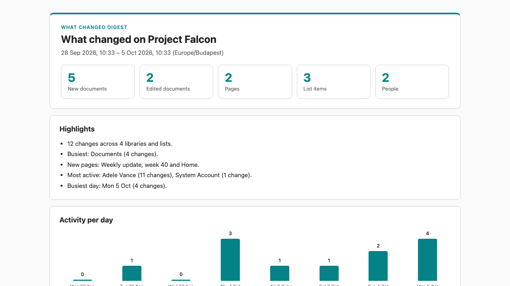

# What Changed Digest

This skill lists what was created or edited on the current site in a time window. The default window is the last 7 days. It covers documents, site pages, and list items, and groups them by library or list and by person. The result is an HTML digest.

The skill only reads site content. It writes one file, the digest, by default to a `Reports` library. If that library doesn't exist, the skill asks before creating it.

`site-storage-heatmap` shows where storage sits and which libraries are hot or cold. This digest lists the individual items that changed in the window, who changed them, and when.

On a busy site the digest is a sample: at most 200 changes per library or list and 600 in total. When changes in the window were left out, the digest says so. On a library or list with more than 5,000 items, SharePoint can refuse the date filter; the digest then lists it as not checked, with the reason.

The skill runs inside Copilot's own plan sandbox. `references/collect.js` and the engine inside the digest template are read from the skill folder and run there unchanged, with no install and no network calls, so the same site and window give the same digest.

## What you get

- An HTML digest saved as `What-changed-<start>-to-<end>-<time>.html` with:
  - KPI cards for new and edited documents, pages, list items, and the number of people involved
  - Up to five highlights, such as the busiest library and new pages
  - Activity per day across the window
  - One table per library or list with each changed item, whether it's new or edited, when, by whom, and the file version
  - A per-person summary
  - A note on what the digest can't see: deleted items, moves, permission changes, and excluded libraries
- A short chat summary with a link to the digest and any libraries or lists that couldn't be checked

Example prompts:

- "What changed on this site this week?"
- "Catch me up on this site since September 22"
- "Create a what-changed digest for the last 14 days and save it in Team Reports"

## SharePoint Skill

| Solution | Author(s) |
| --- | --- |
| what-changed-digest | Kornél Felföldi &#124; [GitHub](https://github.com/xenophobentx) |

## Version history

| Version | Date | Comments |
| --- | --- | --- |
| 1.0 | November 2026 | Initial Release |

## Disclaimer

**THIS CODE IS PROVIDED _AS IS_ WITHOUT WARRANTY OF ANY KIND, EITHER EXPRESS OR IMPLIED, INCLUDING ANY IMPLIED WARRANTIES OF FITNESS FOR A PARTICULAR PURPOSE, MERCHANTABILITY, OR NON-INFRINGEMENT.**

